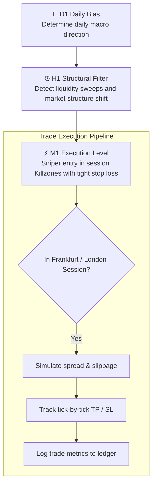

<div align="center">

# 📉 Quantitative Trading & 17-Year Backtesting Engine

**High-performance Python framework for vectorized backtesting of Price Action (Smart Money Concepts) trading strategies across 17 years of minute EUR/USD data (2008–2024).**

[](https://www.python.org/)
[](https://pandas.pydata.org/)
[](https://numpy.org/)
[](LICENSE)

[🇷🇺 Читать на русском](README.md) • [🇬🇧 Read in English](README.en.md)

---

</div>

## 📑 Table of Contents

1. [Project Overview & Quantitative Scope](#1-project-overview--quantitative-scope)
   * [1.1. Context](#11-context)
   * [1.2. Tested Hypothesis](#12-tested-hypothesis)
2. [Architecture & Trading Methodology](#2-architecture--trading-methodology)
   * [2.1. Multi-Timeframe Hierarchy (D1 → H1 → M1)](#21-multi-timeframe-hierarchy-d1--h1--m1)
   * [2.2. Session Modeling & DST Adjustments](#22-session-modeling--dst-adjustments)
   * [2.3. Vectorized Engine & Lookahead Prevention](#23-vectorized-engine--lookahead-prevention)
3. [Risk Metrics & Performance Evaluation](#3-risk-metrics--performance-evaluation)
4. [Project Structure](#4-project-structure)
5. [Technology Stack](#5-technology-stack)
6. [Installation & Execution](#6-installation--execution)
   * [6.1. Dependencies](#61-dependencies)
   * [6.2. Running the Audit](#62-running-the-audit)
7. [Author & Contacts](#7-author--contacts)

---

## 1. Project Overview & Quantitative Scope

### 1.1. Context
Retail trading assumptions frequently degrade when evaluated across market cycles. This repository performs a rigorous quantitative audit of institutional order flow / Smart Money Concepts (ICT) using an uninterrupted tick/minute series of **EUR/USD across 17 consecutive years (2008 to 2024)**.

### 1.2. Tested Hypothesis
Liquidity sweeps occurring during Frankfurt and London session overlaps within an aligned higher-timeframe directional bias (H1 Order Block / Liquidity Sweep) deliver positive mathematical expectation (+EV) under strict Risk-to-Reward parameters (R:R from 1:2 to 1:4).

---

## 2. Architecture & Trading Methodology

### 2.1. Multi-Timeframe Hierarchy (D1 → H1 → M1)



### 2.2. Session Modeling & DST Adjustments
* Dynamic adjustment for Daylight Saving Time (DST) across European and US financial centers.
* Precision Killzone execution: Frankfurt Open, London Open, London Morning Session.

### 2.3. Vectorized Engine & Lookahead Prevention
* Implements `pandas.merge_asof` with `direction='backward'` to strictly link minute bars against closed hourly states, eliminating Lookahead Bias / Data Snooping.
* High-speed `groupby('msk_date')` vectorization processes over 6,000,000 bars across 17 years in tens of seconds.

---

## 3. Risk Metrics & Performance Evaluation

The audit engine computes:
* **Win Rate (%)** and **Loss Rate (%)**;
* **Profit Factor** (Gross Profits / Gross Losses);
* **Maximum Drawdown (MDD)** on closed trades and equity;
* **Recovery Factor** (Net Profit / Max Drawdown);
* **Sharpe & Sortino Ratios** annualized against the risk-free rate.

### 3.1. 📊 Performance Visualizations, Equity Curves & Monte Carlo

<div align="center">

| Cumulative Dynamic Risk Equity Curve | 17-Year Historical Monte Carlo Simulation |
|:---:|:---:|
|  |  |

| Annual Returns Breakdown (2008–2024) | Comparative Performance across 4 Execution Methods |
|:---:|:---:|
|  |  |

</div>

---

## 4. Project Structure

```text
03-quant-trading-backtester/
├── audit_eurusd_17y_sniper.py     # 17-year fast audit script on EUR/USD
├── audit_method4_complete.py      # Detailed multi-year segmented audit
├── analyze_eurusd_method1_full.py # Volatility and session distribution analysis
├── backtester.py                  # Core order matching and fee simulation engine
├── data_loader.py                 # Time series ingestion and resampling utility
├── strategies/                    # Context and pattern recognition modules
│   ├── context_h1.py              # H1 structure and liquidity sweep detector
│   ├── bellissmo_eurusd_golden.py # Golden ratio entry pattern
│   └── bellissmo_1h3m.py          # 1H-3M multi-structure strategy
├── requirements.txt               # Python package requirements
├── .gitignore                     # Data exclusions (*.pkl, *.csv)
├── README.md                      # Russian documentation
└── README.en.md                   # English documentation
```

---

## 5. Technology Stack

* `Python 3.10+`
* `Pandas` (vectorized operations, `merge_asof`, rolling windows)
* `NumPy` (high-performance numerical arrays)
* `Matplotlib` (equity curve generation)
* `SciPy` (statistical distributions)

---

## 6. Installation & Execution

### 6.1. Dependencies
```bash
git clone https://github.com/Andrew123485/quant-trading-backtester.git
cd quant-trading-backtester

python -m venv venv
.\venv\Scripts\activate   # Windows
source venv/bin/activate  # Linux / macOS

pip install -r requirements.txt
```

### 6.2. Running the Audit
> **Note:** To run locally, place your historical pickle file `data_m1.pkl` into the project root.

```bash
python audit_eurusd_17y_sniper.py
```

---

## 7. Author & Contacts

* **Author:** Andrei Vladimirov
* **Role:** Business Analyst / Fintech Developer / Trader
* **Telegram:** [@amorfatimementomoria](https://t.me/amorfatimementomoria)
* **GitHub:** [github.com/Andrew123485](https://github.com/Andrew123485)
