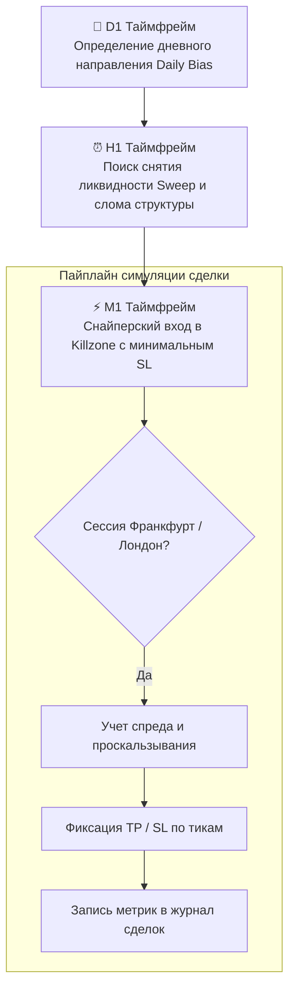
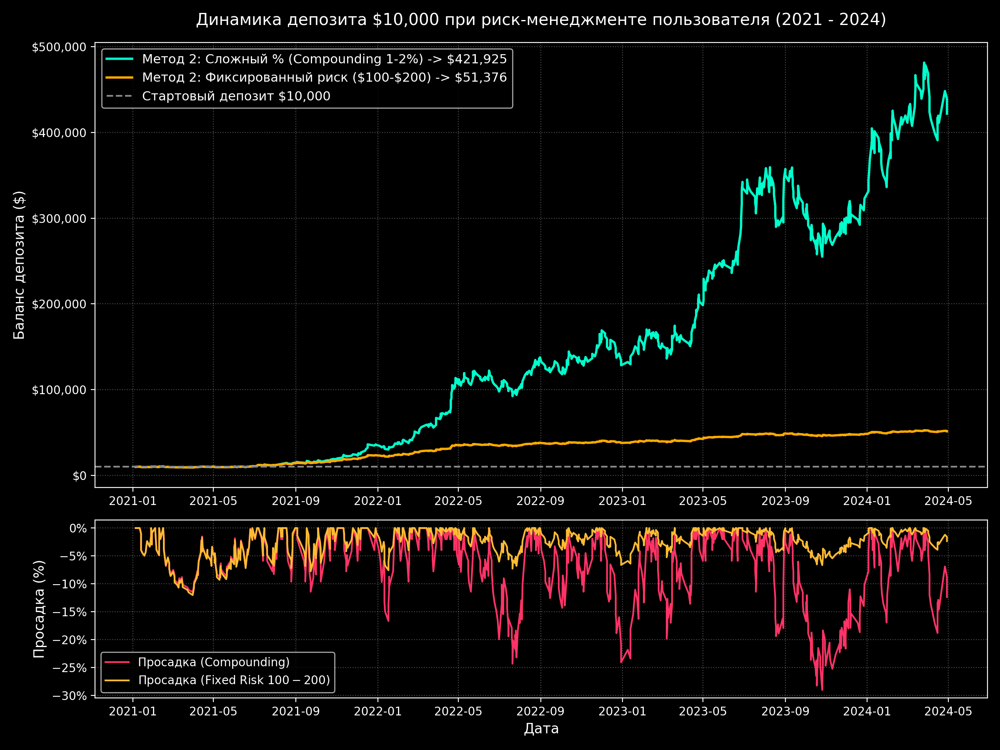
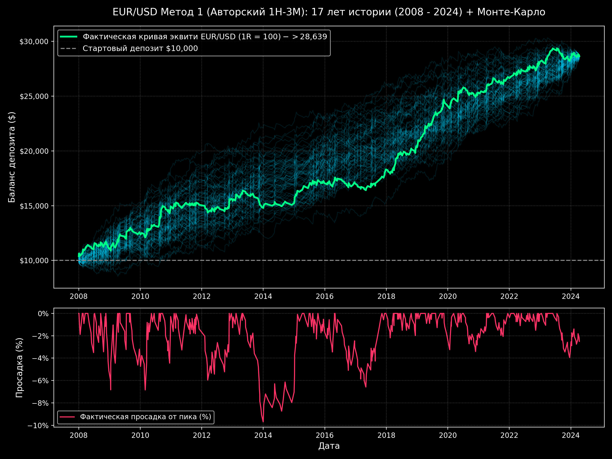
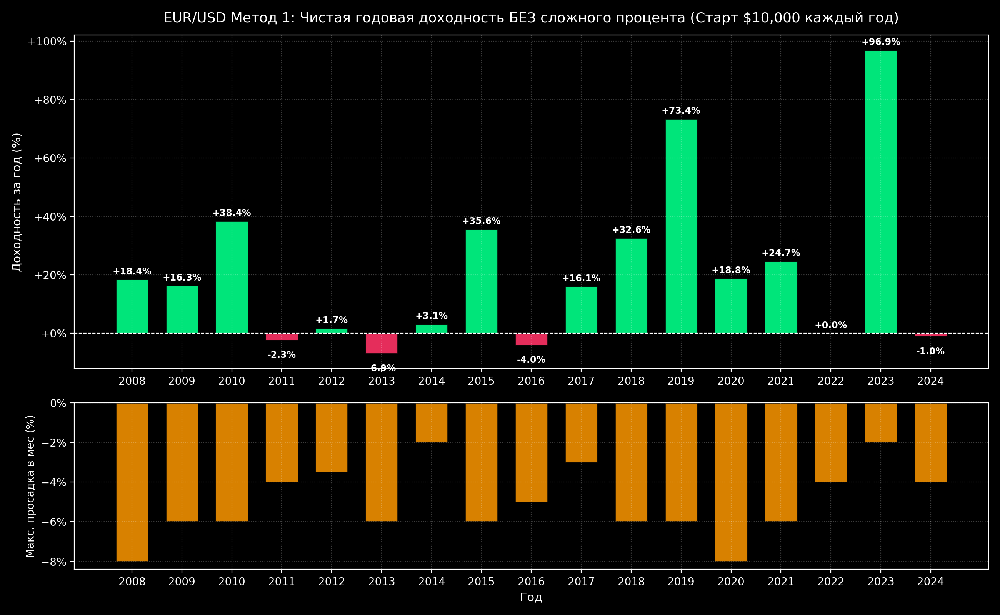
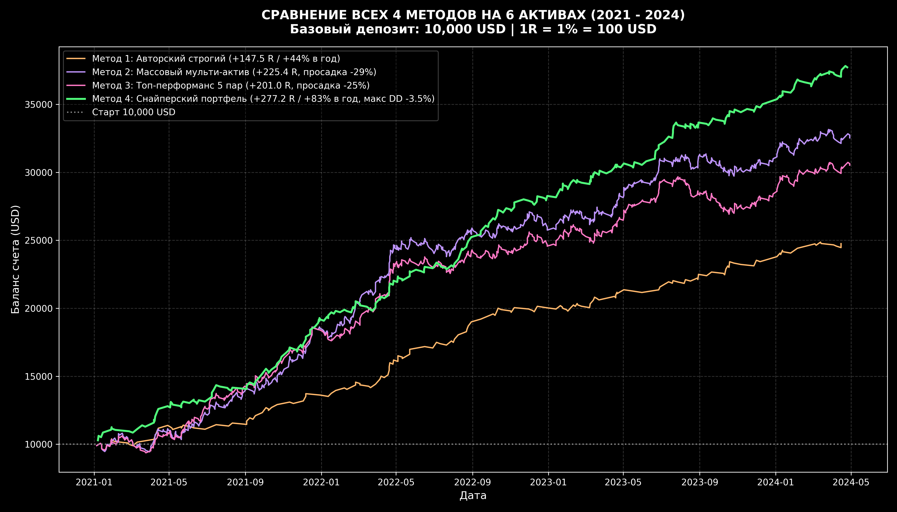

<div align="center">

# 📉 Quantitative Trading & 17-Year Backtesting Engine

**Высокопроизводительный фреймворк на Python для векторного бэктестинга стратегий Price Action (Smart Money Concepts) на 17-летней истории минутных котировок EUR/USD (2008–2024).**

[](https://www.python.org/)
[](https://pandas.pydata.org/)
[](https://numpy.org/)
[](LICENSE)

[🇷🇺 Читать на русском](README.md) • [🇬🇧 Read in English](README.en.md)

---

</div>

## 📑 Содержание

1. [Обзор проекта и исследовательская задача](#1-обзор-проекта-и-исследовательская-задача)
   * [1.1. Контекст исследования](#11-контекст-исследования)
   * [1.2. Проверяемая гипотеза](#12-проверяемая-гипотеза)
2. [Архитектура и торговая методология](#2-архитектура-и-торговая-методология)
   * [2.1. Мультитаймфреймовая иерархия (D1 → H1 → M1)](#21-мультитаймфреймовая-иерархия-d1--h1--m1)
   * [2.2. Учет торговых сессий и часовых поясов](#22-учет-торговых-сессий-и-часовых-поясов)
   * [2.3. Векторизованный анализ и оптимизация скорости](#23-векторизованный-анализ-и-оптимизация-скорости)
3. [Метрики риска и оценка эффективности](#3-метрики-риска-и-оценка-эффективности)
4. [Структура репозитория](#4-структура-репозитория)
5. [Стек технологий](#5-стек-технологий)
6. [Установка и запуск](#6-установка-и-запуск)
   * [6.1. Зависимости](#61-зависимости)
   * [6.2. Запуск аудита](#62-запуск-аудита)
7. [Автор и контакты](#7-автор-и-контакты)

---

## 1. Обзор проекта и исследовательская задача

### 1.1. Контекст исследования
Рыночные мифы о графических паттернах часто терпят неудачу при проверке на длинной дистанции. Цель данного проекта — провести строгий количественный аудит (Quantitative Audit) торговой стратегии на базе концепции ликвидности (Smart Money Concepts / ICT) на непрерывном массиве минутных данных валютной пары **EUR/USD за 17 лет (с 2008 по 2024 год)**.

### 1.2. Проверяемая гипотеза
Формирование манипуляций ликвидностью на стыке Франкфуртской и Лондонской торговых сессий внутри направленного контекста старшего часового таймфрейма (H1 Sweep / Order Block) дает математическое преимущество (Positive Expected Value) при фиксированном соотношении Risk-to-Reward (R:R от 1:2 до 1:4).

---

## 2. Архитектура и торговая методология

### 2.1. Мультитаймфреймовая иерархия (D1 → H1 → M1)



### 2.2. Учет торговых сессий и часовых поясов
* Автоматический расчет перехода на летнее/зимнее время (Daylight Saving Time, DST) в Лондоне и Франкфурте.
* Фильтрация окон ликвидности: Killzones (Frankfurt Open, London Open, London Lunch).

### 2.3. Векторизованный анализ и оптимизация скорости
* Применение `pandas.merge_asof` с направлением `backward` для синхронизации свечей M1 с закрытыми часовыми свечами H1 без утечки данных будущего (Data Snooping / Lookahead Bias).
* Группировка через `groupby('msk_date')` позволила ускорить прогон 17 лет минутных данных (более 6 000 000 баров) до десятков секунд.

---

## 3. Метрики риска и оценка эффективности

Фреймворк автоматически рассчитывает следующие инвестиционные параметры:
* **Win Rate (%)** и **Loss Rate (%)**;
* **Profit Factor** = Сумма прибыли / Сумма убытков;
* **Maximum Drawdown (MDD)** по закрытым позициям и по эквити;
* **Recovery Factor** = Итоговая доходность / Максимальная просадка;
* **Коэффициенты Шарпа (Sharpe Ratio)** и **Сортино (Sortino Ratio)** при безрисковой ставке.

### 3.1. 📊 Графики доходности, эквити и симуляции Монте-Карло

<div align="center">

| Кумулятивная кривая капитала (Equity Curve) | Симуляция Монте-Карло на 17-летней истории |
|:---:|:---:|
|  |  |

| Доходность по изолированным годам (2008–2024) | Сравнение эффективности 4 методов исполнения |
|:---:|:---:|
|  |  |

</div>

---

## 4. Структура репозитория

```text
03-quant-trading-backtester/
├── audit_eurusd_17y_sniper.py   # Быстрый аудит стратегии Sniper на EUR/USD (17 лет)
├── audit_method4_complete.py    # Полный детализированный аудит с разбивкой по годам
├── analyze_eurusd_method1_full.py # Сравнительное исследование волатильности и сессий
├── backtester.py                # Базовый симулятор исполнения ордеров
├── data_loader.py               # Загрузчик и ресемплер временных рядов (M1 -> H1, D1)
├── strategies/                  # Модули стратегий и контекста
│   ├── context_h1.py            # Детектор структуры и снятия ликвидности на H1
│   ├── bellissmo_eurusd_golden.py # Паттерн входа по золотому сечению
│   └── bellissmo_1h3m.py        # Мультиструктурный паттерн 1H-3M
├── requirements.txt             # Зависимости Python
├── .gitignore                   # Исключение тяжелых датасетов (*.pkl, *.csv)
├── README.md                    # Документация на русском
└── README.en.md                 # English documentation
```

---

## 5. Стек технологий

* `Python 3.10+`
* `Pandas` (временные ряды, `merge_asof`, скользящие окна)
* `NumPy` (векторные вычисления)
* `Matplotlib` (построение кривых доходности / Equity Curves)
* `SciPy` (статистические тесты и распределения)

---

## 6. Установка и запуск

### 6.1. Зависимости
```bash
git clone https://github.com/Andrew123485/quant-trading-backtester.git
cd quant-trading-backtester

python -m venv venv
.\venv\Scripts\activate   # Windows
source venv/bin/activate  # Linux / macOS

pip install -r requirements.txt
```

### 6.2. Запуск аудита
> **Примечание:** Для локального воспроизведения положите исторический файл котировок `data_m1.pkl` в корень проекта.

```bash
python audit_eurusd_17y_sniper.py
```

---

## 7. Автор и контакты

* **Автор:** Владимиров Андрей Георгиевич
* **Специализация:** Бизнес-аналитик / Финтех-разработчик / Трейдер
* **Telegram:** [@amorfatimementomoria](https://t.me/amorfatimementomoria)
* **GitHub:** [github.com/Andrew123485](https://github.com/Andrew123485)
